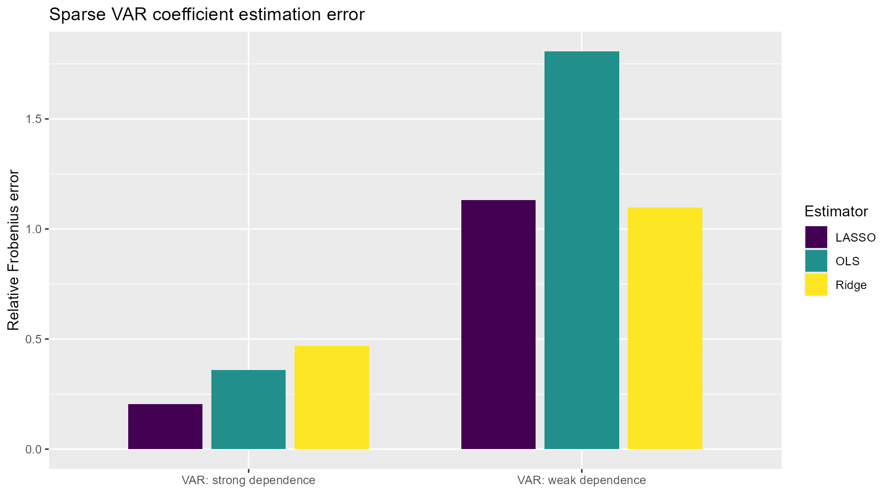
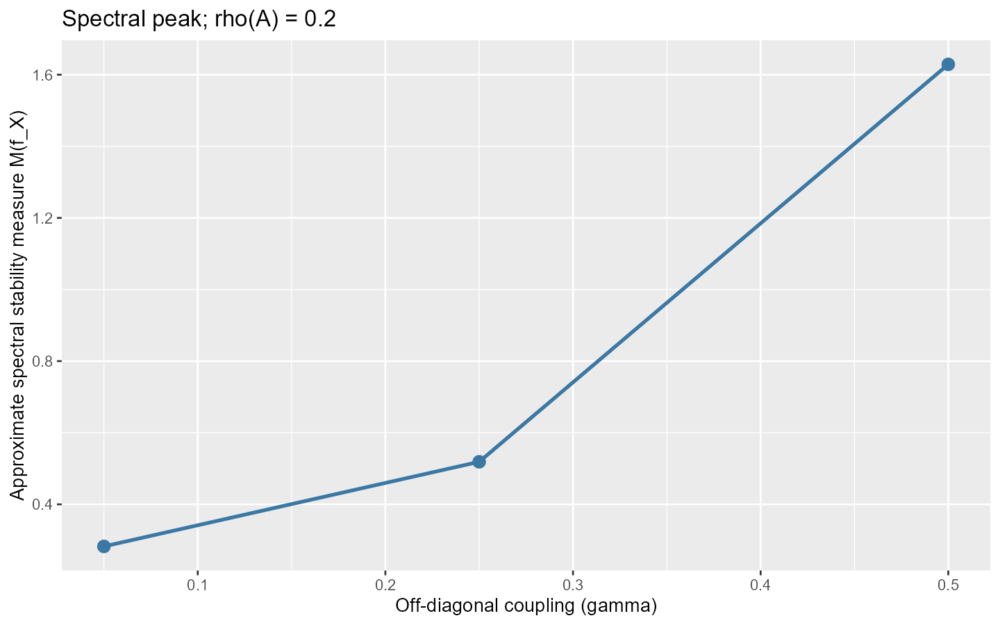
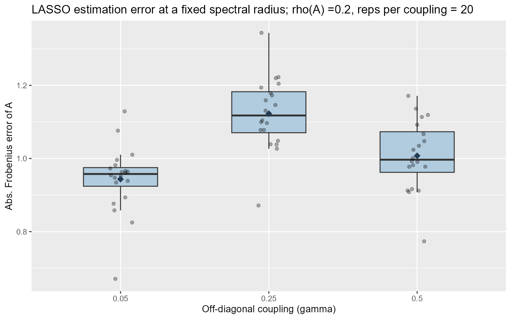

## Abstract

Popular across economics and the social sciences in general, vector autoregressive (VAR) models describe how multiple time series evolve together and offer researchers the opportunity to track multiple variables and their relationships across time. However, estimation becomes difficult when the number of lagged coefficients is large and dependence structures are uncertain. Basu and Michailidis (2015) develop regularized-estimation guarantees for sparse, stationary Gaussian time series using spectral measures of dependence. Their framework is examined through two preliminary simulation exercises: comparing ordinary least squares (OLS), Ridge, and LASSO on sparse VAR(1) data, and varying cross-variable coupling while holding the transition matrix's spectral radius fixed. A small exploratory VARX comparison is also reported. Regularization often improves estimation in these examples; however, support recovery remains imperfect, and the observed estimation errors need not change monotonically with spectral measures. Future work will extend the simulation design to higher lag orders and draw comparisons between VAR and VARX, in addition to applying both methods to examine real-world data on monthly unemployment and economic policy uncertainty.

## Introduction

Unemployment among different racial and ethnic groups may evolve together, respond to common economic shocks, and exhibit different persistence. A VAR model describes these relationships by predicting current values of each series from past values of all series. For $p$ variables and $d$ lags, the model contains $dp^2$ possible lagged coefficients: with $p=20$ and $d=2$, there are 800 coefficients to estimate. This motivates sparse estimation when many relationships are believed to be absent.

Basu and Michailidis (2015) study how LASSO-type regularization can estimate sparse coefficients despite dependence over time. The difficulty is that standard results developed for independent observations cannot simply be applied to a dependent time series. The authors use spectral characteristics of dependence to establish the conditions needed for estimation-error guarantees.

## Methods

The paper studies a stationary Gaussian VAR($d$):

$$
X_t=\sum_{\ell=1}^{d} A_\ell X_{t-\ell}+\varepsilon_t,
\qquad \varepsilon_t\overset{\mathrm{i.i.d.}}{\sim}N_p(0,\Sigma_\varepsilon).
$$

Here $X_t$ is a vector of $p$ variables, $A_\ell$ is the $p\times p$ transition matrix for lag $\ell$, and $\varepsilon_t$ contains unpredictable innovations. The innovation vectors are independent across time, but their entries may be correlated within a time point through $\Sigma_\varepsilon$. The transition matrices are assumed sparse. A stable VAR(1) requires $\rho(A_1)<1$, where $\rho$ denotes the largest absolute eigenvalue. For a VAR with more than one lag, stability is checked through its companion matrix.

After arranging the lagged observations into a regression, the least-squares LASSO estimator minimizes

$$
\widehat\beta=\arg\min_{\beta}
\left\{\frac{1}{N}\|y-Z\beta\|_2^2+\lambda_N\|\beta\|_1\right\}.
$$

The $\ell_1$ penalty encourages coefficients to become exactly zero, and $\lambda_N$ controls the amount of regularization. The paper also studies a covariance-weighted penalized Gaussian likelihood, which can use information about contemporaneously correlated innovations. 

The largest contribution of the paper is their description of time-series dependence using the spectral density $f_X(\theta)$ and its upper and lower spectral eigenvalue measures, $\mathcal M(f_X)$ and $\mathfrak m(f_X)$. These capture features not fully described by $\rho(A)$ alone. The authors establish deviation bounds and a restricted eigenvalue (RE) condition, which together yield coefficient-error guarantees. For example, Proposition 4.1 gives a bound of the form

$$
\|\widehat\beta-\beta^*\|_2\leq\frac{16\sqrt{k}\lambda_N}{\alpha},
$$

where $k$ is the number of truly nonzero coefficients and $\alpha$ measures useful curvature in the RE condition.

## Numerical Experiments

### Experiment 1: Sparse VAR estimator comparison

I generated two stable VAR(1) datasets, each with $p=20$ variables, 200 retained time points, and 200 discarded burn-in observations. Each $20\times20$ transition matrix contains 39 nonzero entries out of 400: 20 on the diagonal and 19 on the first superdiagonal. The diagonal/superdiagonal coefficients are $(0.20,0.05)$ for the weak setting and $(0.80,0.20)$ for the strong setting; the corresponding spectral radii are $0.2$ and $0.8$. Both datasets use the same independent standard-normal innovations.

I estimated each response equation using OLS, Ridge, and LASSO. The 200 observations yield 199 one-lag regression pairs; 119 were used for initial training, 40 for penalty validation, and 40 for testing. Penalties were selected using validation MSE. Relative Frobenius error, $\|\widehat A-A\|_F/\|A\|_F$, measures coefficient recovery, while held-out one-step MSE assesses prediction.

| Estimator | Weak: relative error | Strong: relative error | Weak: test MSE | Strong: test MSE |
|:--|--:|--:|--:|--:|
| OLS   | 1.807 | 0.359 | 1.121 | 1.180 |
| Ridge | **1.098** | 0.470 | 1.027 | 1.323 |
| LASSO | 1.132 | **0.204** | **1.020** | **1.013** |

*Figure 1. Relative Frobenius estimation error for the two sparse VAR settings.*

LASSO had the lowest held-out MSE in both settings, but Ridge achieved slightly lower coefficient error in the weak setting. Since the innovations have variance one, even a model using the true transition matrix would have an expected one-step prediction MSE of one due to random noise. Therefore, the relatively small differences in prediction MSE across the models should be interpreted cautiously. LASSO also selected 137 coefficients in the weak setting despite only 39 true nonzeros (TPR 0.590; FPR 0.316). Thus good prediction does not imply accurate identification of sparse relationships. Only one dataset is used per setting, and changing from weak to strong also increases coefficient magnitudes, so it does not isolate a dependence effect.

### Experiment 2: Fixed spectral radius

To more directly examine dependence, I used $A(\gamma)=0.2I+\gamma U$, where $U$ has ones on the first superdiagonal and $\gamma\in\{0.05,0.25,0.50\}$. Each matrix has the same 39 nonzero positions and $\rho(A)=0.2$, but different cross-variable lagged coupling. The design used 20 Monte Carlo replications per coupling, $p=20$, 200 retained observations, 250 burn-in periods, and a 121-frequency grid to approximate the spectral measures from the *true* transition matrices (seed 92508).

| Coupling $\gamma$ | $\rho(A)$ | Approx. $\mathcal M(f_X)$ | Mean absolute $A$ error | Mean relative $A$ error |
|--:|--:|--:|--:|--:|
| 0.05 | 0.20 | 0.283 | 0.943 | 1.025 |
| 0.25 | 0.20 | 0.519 | 1.123 | 0.796 |
| 0.50 | 0.20 | 1.629 | 1.007 | 0.428 |

{width=48%} {width=48%}

*Figure 2. Approximate upper spectral stability measure (left) and absolute Frobenius LASSO estimation error (right), with 20 replications per coupling.*

Although the spectral radius remains fixed, the approximate upper spectral measure rises sharply. Absolute estimation error increases from $\gamma=0.05$ to $0.25$ and then decreases at $0.50$; this is not inconsistent with a probabilistic upper bound. Relative error decreases more strongly because the norm of the true matrix grows with $\gamma$. Moreover, changing $\gamma$ affects signal magnitudes as well as dependence, so this experiment does not isolate dependence's causal effect on estimation error.

### Exploratory VARX pilot

A third dataset was separately generated as VARX data with one lagged external predictor $Z_{t-1}$, whose true effects were nonzero only for response variables 1 and 3 ($B_1=0.20$, $B_3=0.15$). LASSO fitted without $Z$ had test MSE $1.023$ and relative $A$ error $1.131$; the version including $Z$ had test MSE $1.026$ and relative error $1.113$. Including the weak exogenous signal did not improve test prediction in this single realization. This is an exploratory extension, not evidence that VARX is generally ineffective and further experiments are needed. 

## Future Steps

### Simulations

The next stage will extend $d=1$ to VAR(2) and VAR(3), checking companion-matrix stability, and systematically vary sample size, number of series, sparsity, innovation variance, and contemporaneous innovation correlation. I will use repeated simulations to report variation in absolute/relative coefficient error, LASSO support selection, and out-of-sample MSE. I also plan to compare least-squares LASSO with the covariance-aware penalized likelihood estimator discussed in the paper.

For the final project, which will require a full extension into VARX, we plan to compare VAR and VARX using matched samples, lag orders, forecast horizons, and evaluation periods. Simulated experiments will vary the true size and sparsity of the exogenous effects, including a zero-effect benchmark. This can show when extra predictors supply useful predictive information and when additional estimation complexity hurts performance.

### Real Data

For the real-data application, I propose to study whether **economic policy uncertainty adds predictive information about U.S. unemployment dynamics across racial and ethnic groups**. I have identified five monthly FRED series for **January 2003 through December 2024** (264 calendar months). The four seasonally adjusted unemployment rates originate in the BLS Current Population Survey; the U.S. Economic Policy Uncertainty Index is a candidate exogenous predictor.

| Series | FRED identifier | Proposed model role |
|:--|:--|:--|
| White unemployment rate | `LNS14000003` | Endogenous |
| Black unemployment rate | `LNS14000006` | Endogenous |
| Hispanic/Latino unemployment rate | `LNS14000009` | Endogenous |
| Asian unemployment rate | `LNS14032183` | Endogenous |
| Economic Policy Uncertainty Index | `USEPUINDXM` | Candidate exogenous |

The unemployment rates are percentages of their respective labor forces; the policy uncertainty measure is an index rather than a percentage and is not seasonally adjusted. Hispanic/Latino ethnicity overlaps the BLS racial group definitions, so the categories are not mutually exclusive. 

The series will be aligned by month; I will check missingness, seasonality, and revisions; visualize the four unemployment paths, unemployment gaps, and policy uncertainty; and examine stationarity, possible structural breaks, and lag adequacy. After selecting an appropriate lag order and checking residual diagnostics and stability, I will compare a baseline VAR($d$) for the four unemployment series against my partner's VARX($d$,1), which adds lagged policy uncertainty. Both models will be evaluated using the same chronological test periods and one-step forecasting errors, including errors by racial/ethnic group. Lagging uncertainty does not by itself establish strict exogeneity or causality. The real-data application has $p=4$ and is lower-dimensional than the simulations; it therefore complements rather than replaces the high-dimensional evaluation.

## References

Basu, S., and Michailidis, G. (2015). Regularized estimation in sparse high-dimensional time series models. *Annals of Statistics*, 43(4), 1535--1567. <https://doi.org/10.1214/15-AOS1315>.

Baker, S. R., Bloom, N., and Davis, S. J. (2016). Measuring economic policy uncertainty. *Quarterly Journal of Economics*, 131(4), 1593--1636. <https://doi.org/10.1093/qje/qjw024>.

U.S. Bureau of Labor Statistics, Current Population Survey unemployment rates, via FRED: <https://fred.stlouisfed.org/>. Series: `LNS14000003`, `LNS14000006`, `LNS14000009`, and `LNS14032183`. Economic Policy Uncertainty Index: <https://fred.stlouisfed.org/series/USEPUINDXM>.

